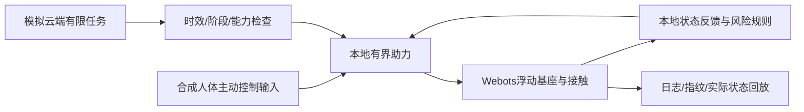

# AI Robotic Joint Mini

[](https://github.com/12313Q2312/AI-Robotic-Joint-Mini/actions/workflows/ci.yml)

面向仍能独立行走、但容易疲劳或上楼吃力老年人的人机协同助力研究。先在电脑中验证助力、任务衔接、危险响应和冲击缓冲，再逐步落实人体、机械与驱动约束。

**已有可运行仿真演示，等待用户验收；尚无真人或临床验证。**

## 看演示与验收

克隆或下载仓库后，Windows双击 `mobility_demo/打开仿真演示.cmd`；也可直接打开 `mobility_demo/viewer/index.html` 回放。

- [演示使用说明](mobility_demo/README.md)
- [逐项验收报告](mobility_demo/ACCEPTANCE_REPORT.md)
- [模型与实现说明](mobility_demo/MODEL_AND_IMPLEMENTATION.md)
- [机器可读结果](data/verification/mobility_20261105/acceptance_decision.json)

| 分项 | 指定合成工况的结果 | 边界 |
|---|---|---|
| 平地协同助力 | 六次交替迈步并停稳；人体等效正功较同质量不助力降低15.54% | 代理机械功，不是老人疲劳或代谢指标 |
| 三阶上楼 | 每阶0.10m，47秒完成；最大躯干倾角约2.9° | 慢速并步；80Nm/4kg配置尚未做硬件闭合 |
| 云端与本地 | 拒绝过期、阶段不符和越界候选；模拟离线后完成有限任务 | 云端为模拟接口，本地为规则/控制基线 |
| 扰动与停止 | 本地停止、小扰动任务完成；大扰动失稳 | 未证明所有跌倒可恢复 |
| 缓冲 | 独立一维有限行程对照，保留触底失败 | 未接入全身碰撞、部署或减伤验证 |

回放共11个场景，包括助力开关、无设备、停止、扰动、新旧上楼及缓冲对照。保留失败，不把软件告警等同已经保护人体。

## 怎样实现



正常运动通过C++关节力矩驱动，无外部托举或位置重置。当前使用理想状态和合成人体等效力矩；真实肌电、交互力估计、老人参数标定、设备传动和自然步态评价仍未实现。云端与本地接口可替换，本轮没有训练或调用付费AI模型。

## 复现与检查

已有单关节、ROS 2、人工面板和CAD资产保留，历史说明见[工程证据](docs/ENGINEERING_EVIDENCE.md)。新仿真不等于旧工程所有未验收项均通过。

```text
python scripts/check_repository.py
python scripts/verify_joint_study.py --output data/verification/ci-check.json
python mobility_demo/verify.py --software-only
```

新仿真的物理运行条件与命令见演示说明。公开仓库含源码、参数、状态抽样、运行指纹及摘要；约39.3MB完整验收证据包保存在本地，不随Git分发。公开CI只检查软件与几何采样，不运行Webots或重建完整原始证据。分项结论以[验收报告](mobility_demo/ACCEPTANCE_REPORT.md)所列原始运行记录为依据。

## 工程约定

- [贡献规范](CONTRIBUTING.md)、[安全反馈](SECURITY.md)、[许可状态](LICENSE.md)、[第三方来源](THIRD_PARTY_NOTICES.md)
- [复现说明](docs/REPRODUCIBILITY.md)、[限制](docs/LIMITATIONS.md)、[仓库设置待办](docs/GITHUB_SETTINGS.md)
- 主分支强制保护尚未启用；CODEOWNERS和CI文件不等同服务端治理已经完成。
- 公开展示不包含私人学习记录、研究筛选或潜在专利资料。用户验收未由助手代签。
