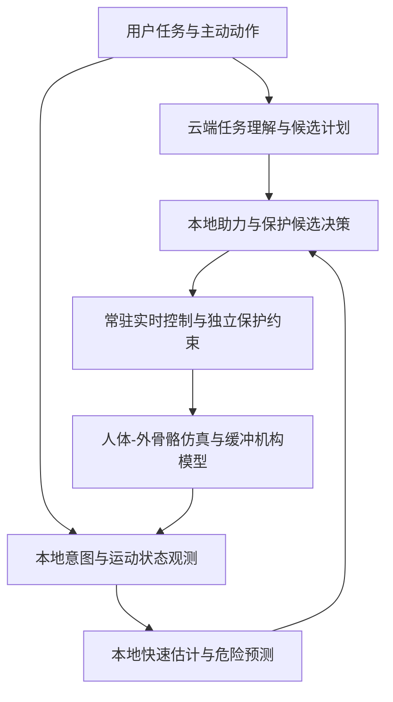

# AI Robotic Joint Mini

[](https://github.com/12313Q2312/AI-Robotic-Joint-Mini/actions/workflows/ci.yml)

**面向老年人下肢行走与上楼助力、危险提前识别及冲击缓冲的外骨骼仿真研究。**

项目希望构建一个能理解使用者意图、协助动作，并在物理能力范围内及时提供保护的穿戴式工程系统。首阶段明确选择**老年人主动参与的下肢平地行走与上楼助力**，将危险预判、平衡恢复和跌倒冲击缓冲纳入核心需求，先在仿真中明确模型、边界和验证方法。

仓库已有 C++ 力矩 PID、ROS 2 通信、人工面板、日志、CAD 测试件及几何补偿离线验证。这些是可复用的单关节工程基础；以下云端/本地智能协同、人体意图识别、危险预测和冲击保护均尚未实现或验收。

## 首阶段关注什么

| 核心方向 | 希望研究的行为 | 当前状态 |
|---|---|---|
| 人机协同助力 | 感知用户下肢主动发力与运动意图，为平地行走和上楼提供时机、方向及幅度合适的助力；停止或改变意图时同步调整 | 需求与方案讨论，尚无人机耦合控制验证 |
| 本地快速危险判断 | 持续观察姿态、运动和接触状态，提前判断失稳或异常，并在本地及时作出受约束的保护响应 | 尚未确定传感器、预测模型、阈值和响应策略 |
| 缓震与跌倒冲击保护 | 区分可恢复失稳与碰撞风险，研究保护动作及结构/执行器/防护装置的实际能量吸收 | 尚未选择缓冲机构或验证减伤效果 |

首阶段目标人群已经明确：**仍能独立行走，但容易疲劳或上楼吃力的老年人**。保留使用者主动发力与自主动作；年龄范围、步态、力量、关节活动度和感知条件仍需建模，不能用一个统一人体参数代表所有老人。当前仅做仿真研究规划，不开展真实人体控制或跌倒试验。

“像年轻人一样行走、上楼”是长期体验愿景；当前应转化为助力时序、人体等效负担、步态平顺性、上楼完成情况和稳定性等可测量目标，不承诺恢复年轻人的身体功能。髋/膝/踝的参与范围、动作参数、自由度和人体参数尚未冻结。助力幅度需要结合姿态、接触、执行器能力和人机作用力确定，不直接将肌肉活动无限放大。

保护方式以助力与保护效果为优先，平衡干预装置和缓冲机构允许替换，尚未锁定硬件方案。

## 云端与本地怎样分工

以下是拟采用的职责方向，尚未实现，不代表已确定具体算法或原创机制。

| 层次 | 拟承担的工作 | 设计要求 |
|---|---|---|
| 云端 AI | 对话、理解任务、提出候选任务计划与高层策略 | 不承担必须即时完成的关节控制或保护闭环 |
| 本地快速智能模块 | 意图/状态估计、风险预测，以及保护响应的候选决策 | 依据本机反馈持续运行；对延迟、误报、漏报和不可用状态作验证 |
| 本地实时控制与独立保护 | 助力控制、候选动作检查、限幅、监督和受约束的降级处理 | 始终运行，不等危险出现才启动；不等待云端回复，保护约束不能由模型输出直接绕过 |
| 机械与执行器 | 传递助力、提供顺应性，并在设计范围内耗散或吸收冲击能量 | 需分别检查缓冲行程、能量容量、驱动限制和人体接触载荷 |



**本地层常驻，危险时切换响应策略。** 网络中断、云端超时或智能模型不可用时，所需的本地控制与保护仍须按明确的模型边界工作；“断网仍安全”目前只是待验证要求。

仿真早期可用明确标注的模拟智能模块、规则或状态机代替尚未接入的模型，检查输入、输出、时序与异常处理。规则占位不称作已训练 AI，合成发力输入不称作真实肌电或人体实验数据。后续是否采用表面肌电（sEMG）、交互力/力矩、关节状态或惯性测量单元（IMU）等信号，需进一步比较。

## 危险预测和缓震怎样验证

保护需要分别验证三个环节：提前识别危险、在仍可恢复时采取约束内响应，以及发生碰撞时实际降低冲击。它们不能只用一个“识别准确率”代替。

| 验证内容 | 需要记录的量 |
|---|---|
| 正常助力 | 意图与助力方向一致性、响应延迟、运动平顺性、交互力/力矩及人体等效负担 |
| 危险预判 | 危险事件定义、提前量、误报/漏报、感知与计算延迟，以及不同人体和扰动下的变化 |
| 保护响应 | 从判断到执行的总时延、姿态/接触变化、驱动饱和、约束违反及失效情形 |
| 冲击缓冲 | 接触峰值载荷/加速度、吸收能量、缓冲行程、触底与局部受力；与相同工况下基线比较 |

具体工况、指标阈值和对照基线尚未确定。提前量必须与整条执行链的时延和物理能力一起评估；软件发出保护指令不等于已经产生保护效果。

在当前设计要求中，平衡恢复判断与缓冲准备需要共同考虑。不能等到恢复尝试失败、碰撞已临近时才开始准备缓冲；应评估剩余时间、干预能力、缓冲部署/起效时延和多种误判情形。这里的“可恢复/不可恢复”只是在给定模型与能力边界内的估计，不是AI对所有跌倒作出的确定判断。

首版验证可按平地助力、上楼助力、受扰后的平衡恢复、碰撞缓冲分组推进，各组明确初始条件、接触、人体参与和失效边界，最终再检查衔接。该顺序是仿真计划建议，不代表已经获准启动实验。

AI负责估计与决策，缓震需要可验证的物理能量吸收路径；弹性、阻尼、驱动控制或独立防护装置均只是待比较的技术选择。不能用“关节锁住”“电机停止”直接证明冲击被吸收，也不承诺所有跌倒都可被阻止或避免受伤。

## 已有工程基础及证据边界

| 模块 | 已有资产 | 验证边界 |
|---|---|---|
| 独立控制 | Webots C++ 力矩 PID、P/PD/PID 与抗饱和示例数据 | 历史实验配置各自独立，不代表当前全系统验收 |
| ROS 2 集成 | C++ 插件、消息、监督、启动与采集代码 | 本次 CI 不构建 ROS 2 或启动 Webots |
| 人工面板 | 角度/键盘输入、控制权、心跳、状态与日志 | 合成 HTTP/前端测试不替代真实反馈验收 |
| 配对夹具 | 同参考、同参 PID、几何势能等效补偿 | 理想固定轴模型；实际双侧 Webots 运动未验收 |
| CAD | T001 原生 SolidWorks 测试零件及名义参考图 | 不是完整装配、质量/惯量认证或加工图 |
| 回归检查 | Python、C++、前端及理想动力学测试 | 只支持对应的软件行为与模型假设 |

## 第一层：单侧膝关节上楼助力闭环（仅仿真）

这一层是电脑里的单侧膝关节闭环，用来检查合成意图、助力命令、安全监督和简化植物模型是否按约定连接。它不涉及真人、真实表面肌电，也不给出防跌倒结论。全身 10 关节、危险预测、缓冲机构和云端连接不在这一层。

意图接口可以替换。当前 v1 是合成的期望屈膝轨迹，人体膝关节力矩由有界跟踪器产生。代码、话题 `/knee_stair/intent_synthetic` 和日志都标成 **synthetic**。助力有三条同条件对照：关闭、导纳（生成期望运动，内环沿用既有力矩 PID 的抗饱和递推，力矩上限保持 24 Nm）、以及从 PR #3 复制的比例分担 AssistPolicy。所有外骨骼电机力矩都经过同一个 `JointSafetyCore`。监督器的 40 Nm 是命令合理性检查，不是执行器力矩上限。进入植物或电机话题之前，力矩还经过唯一的 `clamp_actuator_torque`，上限是 `actuator_torque_limit_nm`（24 Nm）。状态是 `NORMAL` / `LIMITED_ASSIST` / `DAMPING_ONLY` / `E_STOP`。`E_STOP` 把助力力矩置 0，外骨骼进入被动阻尼，并锁存到手动 `reset`；`/joint/safe_target_angle` 保持原有数字合同。`/joint/safety_state` 只发布、不接收命令。植物模型是人体小腿和外骨骼连杆，中间有弹簧阻尼绑带；交互力矩读绑带约束，不读电机输出。上楼负载是随屈膝变化的重力矩，按膝关节承担的体重份额缩放。CI 跑的是不依赖 Webots 的植物模型。可选 Webots 文件只保留裁剪几何，没有这套绑带动力学。

| 内容 | 标记 | 依据 |
|---|---|---|
| 可替换意图接口；v1 合成轨迹与有界人体力矩 | implemented | `knee_stair_l1/intent.py`，`human.py` |
| 导纳期望运动 + 24 Nm PID 上限；AssistPolicy 对照 | implemented | `torque_pid.py`、`assist_policy.py`、`controller.py` |
| 合并后的安全状态机与只读 `/joint/safety_state` | implemented | `knee_stair_l1/safety.py`，`joint_safety_node.py` |
| 重力负载、绑带约束、硬限位异常记录 | implemented | `knee_stair_l1/plant.py` |
| 可选单膝 Webots 几何 | implemented | `knee_stair_l1/webots/worlds/knee_stair_l1.wbt`（未运行） |
| 四项故障注入，以及 E_STOP 后力矩保持 0、角度不跳变 | verified | `tests/test_knee_stair_l1_faults.py`，`tests/test_knee_stair_l1_safety.py` |
| 30 个种子的配对指标与通过/失败记录 | experimental | [汇总 JSON](data/verification/knee_stair_l1/metrics_summary.json)，[小样本](data/verification/knee_stair_l1/metrics_sample.json) |
| 单自由度重力矩、绑带舒适阈值 15 Nm、固定髋 | theoretical | `knee_stair_l1/config/default.json` 里的 `load.assumption` 与 `metrics.comfort_basis` |

真人助力效果、真实肌电识别和防跌倒没有归入上表的任何一个标记，本层不报告这些结果。

假设和来源：

| 假设 | 来源 |
|---|---|
| 体重在 50–85 kg 内抽取，名义锚点是合成的 70 kg | 配置 `randomization` 与 `load.assumption`，不是实测队列 |
| 台阶高 0.13–0.18 m，参考高度 0.15 m | 配置。0.15 m 是抽取区间中点，当作一个整数级踏步高度 |
| 重力矩 = 份额 × 体重 × g × 力臂 × (台阶高 / 0.15) × sin(屈膝) | `load.assumption`。理论力矩，不是步态反推 |
| 膝关节承担体重的份额是 0.4 | 配置里的理论份额 |
| 意图幅度 ±20%，起始时间 ±100 ms | 本轮要求的抽取范围，写在 `randomization` |
| 绑带刚度在名义值上下 ±30% | 配置。名义刚度是模型参数 |
| 每个种子抽取角度噪声 0.002–0.01 rad、角速度噪声 0.02–0.1 rad/s | `sensor_noise.level_note`。不是编码器说明书 |
| 舒适阈值 15 Nm = 0.08 m × 187.5 N | `metrics.comfort_basis`。设计假设，不是舒适性试验 |
| 屈膝上限 2.2 rad | `knee_stair_l1/TUNING.md`。模型活动范围，不是测得关节活动度 |
| 固定 2 步队列的 p50/p95/max 是仿真环路时延，不是真实系统时延 | `metrics_summary.json` 的 `latency_definition` |

必须单独记下的限制：

- 全部结果都只是仿真。意图是合成的，CI 不运行 ROS 2 或 Webots。
- 导纳在正功降幅上差于 AssistPolicy，在力矩 RMS 上与它相当。没有为了让导纳反超而调参。
- 即使 1.5 s 的延迟下助力仍然有效，说明合成意图太可预测，助力接近重力补偿。L2 必须加入意图突变和动作中途停止。

延迟加在进入安全监督器之前的意图和传感器上。0–50 ms 网格以及 100、200、500 ms 的稳态都是 `NORMAL`，见 [latency_sweep.md](data/verification/knee_stair_l1/latency_sweep.md) 和 [图](data/verification/knee_stair_l1/latency_sweep.png)。监督器按收到时刻盖时间戳，没有信号新鲜度检查。这是 L2 必做项，本层不实现。±30% 的力臂和舒适阈值扫描见 [sensitivity.json](data/verification/knee_stair_l1/sensitivity.json)。24 Nm 上限没有提高。`E_STOP` 是软件锁存，不是硬件急停。

复现（仓库根目录，只需 Python 标准库）：

```text
python scripts/run_knee_stair_l1_metrics.py --check
python scripts/run_knee_stair_l1_sweeps.py --check
python -m unittest tests.test_knee_stair_l1_faults -v
python scripts/check_repository.py
python scripts/verify_joint_study.py --output data/verification/local-check.json
```

细节、话题和故障对照见 [knee_stair_l1/README.md](knee_stair_l1/README.md)。

## 快速开始

1. 克隆仓库，进入根目录。
2. 确认已有 Python 3.12+、Node.js 22、支持 C++17 的 g++ 或 clang++。
3. 执行以下离线检查，无需安装 Python/npm 依赖：

```text
git clone https://github.com/12313Q2312/AI-Robotic-Joint-Mini.git
cd AI-Robotic-Joint-Mini
python scripts/check_repository.py
python scripts/verify_joint_study.py --output data/verification/local-check.json
```

Linux 可将 `python` 改为 `python3`。验证器不会启动仿真或发送运动指令；返回 0=通过、1=失败、2=阻塞。详细步骤见 [复现说明](docs/REPRODUCIBILITY.md)。

## 已有单关节控制与证据链


图示为已有工程的数据流。写入力矩 API 的命令不等于电机实测力矩；参考限速不保证实际关节全过程限速，详见 [局限](docs/LIMITATIONS.md)。

## 目录与入口

| 路径 | 用途 |
|---|---|
| `simulation/webots/` | 独立世界与控制器 |
| `ros2_ws/src/ai_robotic_joint_ros2/` | ROS 2 包、C++ 插件、面板和三类场景 |
| `research/gravity_compensation/` | 已有几何/势能计算与公开来源 |
| `mechanical/` | T001 原生测试件与 URDF 检查夹具 |
| `data/processed/`、`assets/plots/` | 历史小体积数据与曲线 |
| `data/verification/` | 本公开副本的离线验证摘要和文件清单 |
| `scripts/`、`tests/` | 生成、分析、验证入口和回归用例 |
| `.github/` | CI、责任人、Issue/PR模板与依赖更新 |

继续阅读 [工程证据](docs/ENGINEERING_EVIDENCE.md)、[当前状态](PROJECT_STATUS.md)、[贡献规范](CONTRIBUTING.md)、[许可状态](LICENSE.md) 和 [交付记录](docs/REPOSITORY_DELIVERY.md)。

## 相关公开研究与阅读边界

- [老年人多任务髋部助力研究（2026，arXiv v2）](https://arxiv.org/html/2603.22580v2)：在8名老年参与者中研究平地、坡道、楼梯等任务的关节力学效应，实验使用防跌吊带；不据此证明本项目防跌、减伤或日常环境效果。
- [老年人上下楼的关节功率缺口研究（2022）](https://pubmed.ncbi.nlm.nih.gov/38486914/)：比较老年与年轻参与者的运动力学，用于讨论助力关节和时机；不是本项目的执行器规格或控制验证。
- [Myoelectric model-based controlled exosuit](https://pmc.ncbi.nlm.nih.gov/articles/PMC7805765/)：肌电驱动助力与人体参与的研究实例，实验为健康受试者的上肢任务；不据此证明本项目下肢助力或老年人使用效果。
- [Preimpact fall detection for wearable airbags](https://pmc.ncbi.nlm.nih.gov/articles/PMC7085770/)：涉及跌倒前识别、提前量与误报，主要实验来自健康年轻男性的模拟跌倒；不能直接迁移其阈值或性能到老人。
- [Wearable airbag models after stroke](https://pmc.ncbi.nlm.nih.gov/articles/PMC9205156/)：说明不同人群数据及触发时机需要专门评估；该研究采集期间禁止气囊实际部署，不能用检测结果代替实际缓冲效果。

这些来源用于明确已有研究和验证边界；项目未复现其结果，也不据通用模块组合认定创新。

公开内容包含既有工程资产及用户明确提出的高层方向，不披露内部研究细节。仓库可公开阅读，具体使用与分发权利以许可和第三方声明为准。此次更新为说明文档调整，没有新增控制实现、模型训练、仿真运行或真人验证。
